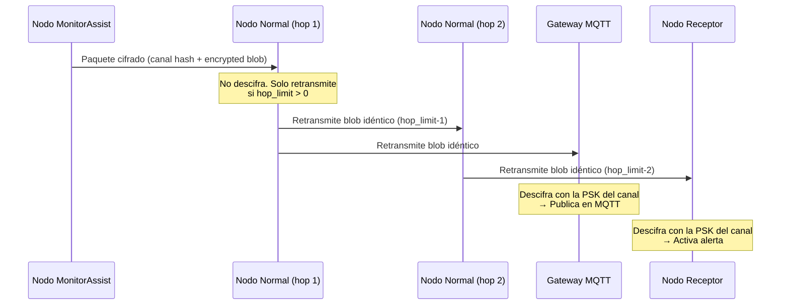
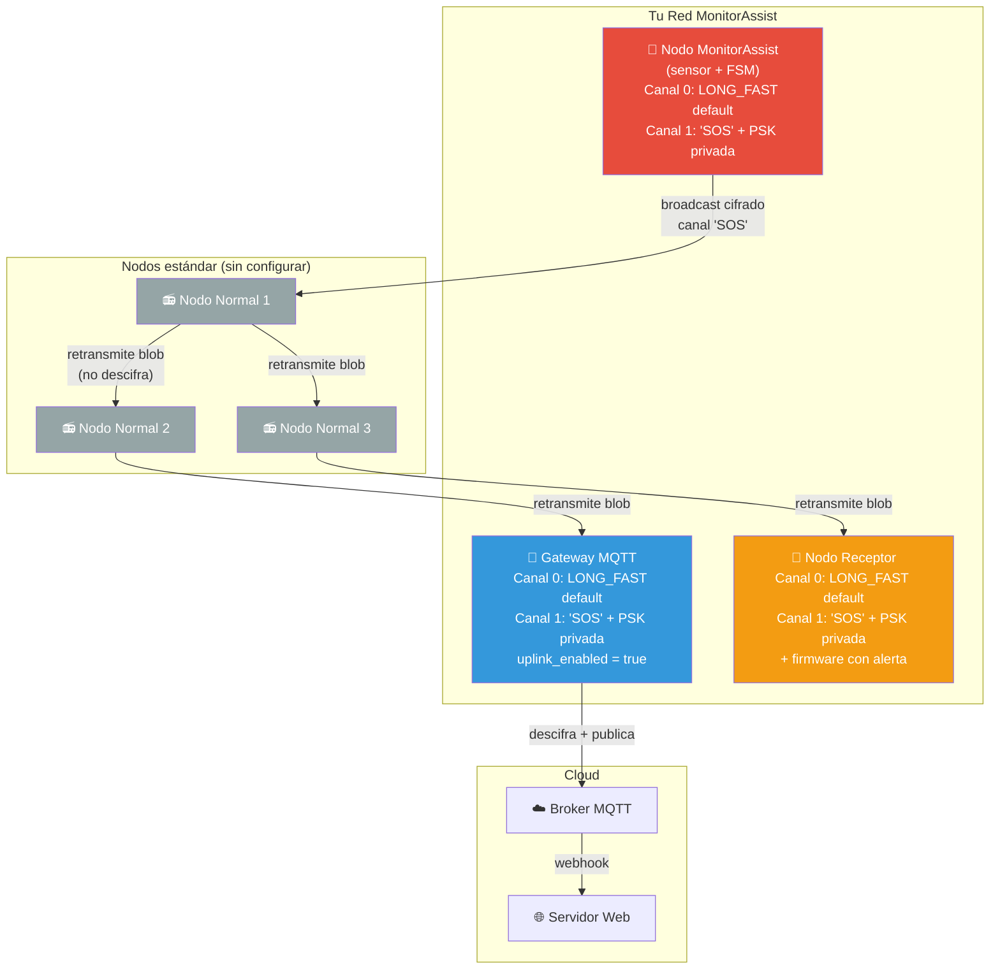

# Estrategia de Envío LoRa para MonitorAssist

## Contexto

Tu sistema MonitorAssist necesita enviar mensajes de asistencia (telemetría médica con BPM, GPS, flags de emergencia) a través de la red mesh LoRa con estos requisitos:

1. **Saltos por nodos naturales** — El mensaje debe propagarse a través de nodos Meshtastic estándar (sin MonitorAssist) que actúan como repetidores
2. **Captura por gateway MQTT** — Un gateway LoRa→MQTT debe poder recibir y publicar el mensaje en un broker MQTT para que un servidor web lo procese
3. **Recepción por nodo notificador** — Un nodo LoRa final dedicado debe recibir la alerta y activar una notificación
4. **Privacidad** — El contenido del mensaje debe ser inaccesible para nodos que no pertenezcan a tu sistema

---

## Cómo funciona el reenvío en Meshtastic (clave para tu decisión)

> [!IMPORTANT]
> Los nodos intermedios **retransmiten el paquete cifrado tal cual** sin necesidad de descifrarlo. El reenvío opera a nivel de radio sobre el blob binario encriptado. Un nodo solo necesita "entender" un paquete si quiere **procesarlo localmente** (mostrar texto, ejecutar un módulo, etc.).

### Flujo de un paquete broadcast en la mesh:



Esto está confirmado en el código del [Router.cpp](file:///d:/TFM/MonitorAssist_Meshtastic_TFM/src/mesh/Router.cpp#L346-L396): cuando un paquete ya está cifrado (`encrypted_tag`), se reenvía sin tocarlo. Solo si es `decoded_tag` (generado localmente) se cifra antes de enviar.

---

## Análisis de las 3 estrategias posibles

### Opción A: Canal primario (index 0) — PSK por defecto de LONG_FAST

| Aspecto | Evaluación |
|---------|-----------|
| **Retransmisión por nodos normales** | ✅ Funciona — todos comparten la misma PSK default |
| **Gateway MQTT** | ✅ Funciona — el gateway ya escucha el canal primario |
| **Nodo receptor** | ✅ Funciona — puede filtrar por portnum `PRIVATE_APP` |
| **Privacidad** | ❌ **NULA** — cualquier nodo con la PSK default (prácticamente todos) puede descifrar el contenido y ver BPM, GPS, etc. |

> [!CAUTION]
> Esta es tu configuración actual (`p->channel = 0`). Cualquier persona con un nodo Meshtastic en LONG_FAST puede ver tus datos médicos.

---

### Opción B: Canal secundario (index 1+) con PSK propia ⭐ RECOMENDADA

| Aspecto | Evaluación |
|---------|-----------|
| **Retransmisión por nodos normales** | ✅ **Funciona** — los nodos retransmiten el blob cifrado sin descifrarlo |
| **Gateway MQTT** | ✅ Funciona — si el gateway tiene la misma PSK en su canal secundario con `uplink_enabled = true` |
| **Nodo receptor** | ✅ Funciona — si tiene la misma PSK en su canal secundario |
| **Privacidad** | ✅ **AES-256 con PSK propia** — solo los nodos con tu clave pueden descifrar |

> [!TIP]
> Esta opción es la **óptima**. Combina todas las ventajas: los nodos normales retransmiten sin problemas (porque el reenvío es a nivel de blob cifrado), y solo los nodos autorizados (gateway + receptor) pueden leer el contenido.

---

### Opción C: PKI (Curve25519 punto a punto)

| Aspecto | Evaluación |
|---------|-----------|
| **Retransmisión por nodos normales** | ✅ Funciona (solo para mensajes dirigidos, no broadcast) |
| **Gateway MQTT** | ❌ **NO funciona directamente** — PKI cifra de extremo a extremo para un solo destinatario |
| **Nodo receptor** | ✅ Solo si es el destinatario directo del paquete |
| **Privacidad** | ✅ Máxima — solo emisor y receptor pueden descifrar |

> [!WARNING]
> PKI **no es compatible con broadcast**, y necesitas que **dos** entidades reciban el mensaje (gateway + receptor). Tendrías que enviar dos paquetes separados, duplicando el uso del canal radio.

---

## Recomendación: Opción B — Canal secundario con PSK AES-256

### Arquitectura propuesta



### ¿Por qué los nodos normales retransmiten sin problemas?

Revisando [Router.cpp L346-L386](file:///d:/TFM/MonitorAssist_Meshtastic_TFM/src/mesh/Router.cpp#L346-L386):

```cpp
// Si el paquete ya está cifrado (retransmisión), se envía tal cual
if (p->which_payload_variant == meshtastic_MeshPacket_encrypted_tag) {
    // No se cifra de nuevo — simplemente se reenvía el blob
}
```

Los nodos normales:
- Reciben el paquete cifrado con tu PSK del canal "SOS"
- **No pueden descifrarlo** (no tienen la PSK) → no ejecutan ningún módulo
- **Sí lo retransmiten** porque el mecanismo de flooding opera sobre el paquete cifrado, sin necesidad de entenderlo
- Solo decrementan `hop_limit`

### ¿Por qué el gateway MQTT captura el mensaje?

Revisando [MQTT.cpp L766-L800](file:///d:/TFM/MonitorAssist_Meshtastic_TFM/src/mqtt/MQTT.cpp#L766-L800), la función `onSend()`:

```cpp
// Se llama cuando un paquete es enviado/retransmitido
void MQTT::onSend(const meshtastic_MeshPacket &mp_encrypted, 
                  const meshtastic_MeshPacket &mp_decoded, 
                  ChannelIndex chIndex) {
    // ...
    // Verifica si el canal tiene uplink habilitado
    if (!(ch.settings.uplink_enabled || isPKIEncrypted))
        return;
    // Si sí → publica en MQTT
}
```

**El gateway necesita**: la misma PSK en su canal secundario + `uplink_enabled = true`. Cuando recibe y descifra el paquete correctamente, lo publica en MQTT.

---

## Cambios de código necesarios

### 1. [MODIFY] [MonitorAssistModule.cpp](file:///d:/TFM/MonitorAssist_Meshtastic_TFM/src/modules/MonitorAssist/MonitorAssistModule.cpp)

Cambiar `sendAssistTelemetry()` para usar el canal secundario (index 1) en vez del primario:

```diff
 void MonitorAssistModule::sendAssistTelemetry(uint8_t bpm, uint8_t flags) {
   // ... (preparar msg sin cambios) ...

   auto p = packetPool.allocZeroed(0);
   // ...
   p->id = generatePacketId();
   p->to = 0xFFFFFFFF; // Broadcast
   p->want_ack = false;
   p->hop_limit = 3;
-  p->channel = 0;
+  p->channel = 1; // Canal secundario "SOS" con PSK privada

   p->which_payload_variant = meshtastic_MeshPacket_decoded_tag;
   p->decoded.portnum = meshtastic_PortNum_PRIVATE_APP;
```

> [!NOTE]
> `p->channel` es el **índice del canal** (0-7) en el momento del envío. Luego, [Router.cpp](file:///d:/TFM/MonitorAssist_Meshtastic_TFM/src/mesh/Router.cpp#L681-L684) lo reemplaza por el **hash** del canal para la transmisión over-the-air. El hash se calcula a partir del nombre del canal + la PSK (ver [Channels.cpp L39-L52](file:///d:/TFM/MonitorAssist_Meshtastic_TFM/src/mesh/Channels.cpp#L39-L52)).

### 2. Configuración de los 3 nodos del sistema

Cada nodo (MonitorAssist, Gateway MQTT, y Receptor) necesita tener configurado el **mismo canal secundario** con:

| Parámetro | Valor |
|-----------|-------|
| **Canal index** | 1 (secundario) |
| **Nombre** | `SOS` (o cualquier nombre descriptivo) |
| **PSK** | Una clave AES-256 de 32 bytes, idéntica en los 3 nodos |
| **Modem preset** | `LONG_FAST` (heredado del canal primario) |
| **uplink_enabled** | `true` solo en el Gateway MQTT |

#### Configuración vía app Meshtastic o CLI:

```bash
# En cada uno de los 3 nodos:
meshtastic --ch-index 1 --ch-set name "SOS"
meshtastic --ch-index 1 --ch-set psk random  # genera AES-256 aleatorio
meshtastic --ch-index 1 --ch-enable

# Solo en el Gateway MQTT:
meshtastic --ch-index 1 --ch-set uplink_enabled true
```

> [!IMPORTANT]
> Después de generar la PSK en un nodo, debes exportarla y copiarla exactamente a los otros dos nodos. La forma más práctica es usar un **URL de canal compartido** desde la app Meshtastic.

#### Alternativa: Preconfigurar vía `userPrefs.jsonc` (build-time):

Puedes definir la PSK del canal 1 directamente en build flags para que los nodos MonitorAssist arranquen ya configurados:

```ini
# En platformio.ini del entorno MonitorAssist:
build_flags =
    -D USERPREFS_CHANNELS_TO_WRITE=2
    -D 'USERPREFS_CHANNEL_1_PSK={0xAA,0xBB,...,0xFF}'  ; 32 bytes AES-256
    -D 'USERPREFS_CHANNEL_1_NAME="SOS"'
```

Esto se procesa en [Channels.cpp L165-L183](file:///d:/TFM/MonitorAssist_Meshtastic_TFM/src/mesh/Channels.cpp#L165-L183).

### 3. Configuración MQTT del Gateway

El gateway necesita:
- `moduleConfig.mqtt.enabled = true`
- `moduleConfig.mqtt.encryption_enabled = true` (para publicar el paquete cifrado en MQTT, el servidor web lo descifrará)
  - **O bien** `encryption_enabled = false` si prefieres que el gateway publique el protobuf decodificado directamente
- Servidor MQTT **privado** (recomendado) para evitar las restricciones del servidor público de Meshtastic
- Opcionalmente `json_enabled = true` para publicar también una versión JSON legible

### 4. Nodo Receptor — Dos opciones

**Opción A (recomendada para TFM):** El nodo receptor ejecuta firmware MonitorAssist con `handleReceivedProtobuf()` que ya tienes implementado. Solo necesita tener el canal "SOS" configurado con la misma PSK.

**Opción B (más simple):** Un ESP32 con WiFi actuando como segundo gateway, que recibe el paquete LoRa y lo procesa localmente (sirena, notificación push, etc.).

---

## Resumen de la topología de seguridad

```
┌─────────────────────────────────────────────────────────────┐
│  Canal 0 (LONG_FAST default)                                │
│  PSK: default (pública)                                     │
│  Todos los nodos: mesh normal, posición, texto, etc.        │
│  Los nodos normales retransmiten TODOS los paquetes         │
│  (incluyendo los del canal 1 que no pueden descifrar)       │
├─────────────────────────────────────────────────────────────┤
│  Canal 1 ("SOS")                                            │
│  PSK: AES-256 privada (32 bytes)                            │
│  Solo 3 nodos conocen la clave:                             │
│    • Nodo MonitorAssist (envía)                             │
│    • Gateway MQTT (descifra → publica en broker)            │
│    • Nodo Receptor (descifra → activa alerta)               │
│  Resto de nodos: retransmiten el blob pero NO leen nada     │
└─────────────────────────────────────────────────────────────┘
```

---

## Open Questions

> [!IMPORTANT]
> **¿Cómo quieres distribuir la PSK entre los nodos?**
> - **Build-time** con `USERPREFS_CHANNEL_1_PSK` → más cómodo para el nodo MonitorAssist, pero requiere recompilar si la clave cambia
> - **Runtime** vía app Meshtastic → más flexible, pero manual para cada nodo
> - **Combinación**: preconfigura el canal 1 en el firmware MonitorAssist, y configura manualmente gateway + receptor con la misma clave

> [!IMPORTANT]
> **¿El gateway MQTT será un dispositivo dedicado (p.ej. un Heltec V3 con WiFi) o usarás el servidor MQTT público de Meshtastic?**
> Si usas un servidor MQTT privado, tienes control total del formato y puedes publicar los datos decodificados. Con el servidor público, hay restricciones de filtrado (`DontMqttMeBro`, etc.).

> [!IMPORTANT]
> **¿Quieres que el nodo receptor ejecute tu firmware MonitorAssist (con `handleReceivedProtobuf`) o prefieres un enfoque más simple como un segundo gateway MQTT local?**

## Verification Plan

### Verificación funcional
1. Compilar con `pio run -e rak4631` tras cambiar `p->channel = 1`
2. Configurar canal "SOS" con PSK compartida en 2 nodos de prueba
3. Verificar que un tercer nodo (sin la PSK) retransmite el paquete pero no lo descifra
4. Verificar que el nodo con la PSK recibe y decodifica correctamente el protobuf

### Verificación MQTT
1. Configurar gateway con `uplink_enabled = true` en el canal 1
2. Suscribirse al topic MQTT y verificar que los mensajes llegan
3. Verificar que el payload protobuf o JSON contiene los campos de MonitorAssistTelemetry
